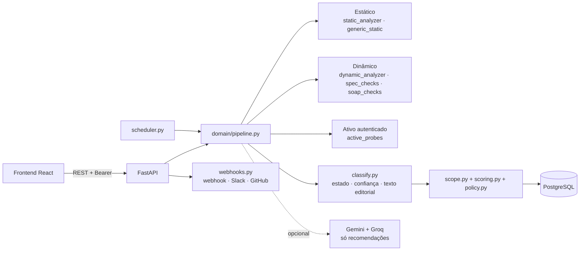

# Arquitetura

## Visão geral



## Diretórios

```
backend/
  app/
    main.py               # app FastAPI, migração leve de colunas, auditoria, agendador
    auth.py · security.py # login/papéis (scrypt + token HMAC) · criptografia de segredos (Fernet)
    netguard.py           # proteção contra SSRF para destinos acessados pelo servidor
    scheduler.py          # execução de scans agendados
    api/                  # rotas (targets, credentials, scans, findings, policies, dashboard, integrations, auth, ai)
    db/                   # modelos SQLAlchemy e sessão
    domain/
      pipeline.py         # orquestra um scan completo
      static_analyzer.py  # regras de código específicas de Next.js/Prisma
      generic_static.py   # regras de código independentes de framework (segredos, TLS, SQL, JWT...)
      dynamic_analyzer.py # requisições ao alvo em execução (headers, CORS, rate limit, TLS, rotas configuradas)
      active_probes.py    # com login: JWT, rota protegida, exposição, BOLA, BFLA, mass assignment
      spec_checks.py      # guiado pela spec OpenAPI: rotas públicas/protegidas, BFLA automático, fluxos, SSRF, debug
      soap_checks.py      # WSDL exposto e política WS-Security
      endpoint_discovery.py
      knowledge.py        # base editorial: critérios, impacto, cenário, limitações, CWE de CADA verificação
      classify.py         # status bruto -> estado + confiança + texto editorial + ativo afetado
      scope.py            # o que foi/não foi executado, motivo e cobertura
      scoring.py · policy.py
      routes_view.py      # visão "rotas e verificações" derivada dos achados
      policy_catalog.py   # catálogo das 50 políticas
      ai_*.py             # recomendações por IA (nunca decidem um resultado)
  targets/                # alvos de exemplo (JSON)
  tests/                  # pytest: regras, políticas vs alvo de laboratório, API, persistência
  scripts/                # gera fixtures de contrato e docs/politicas.md
frontend/src/
  pages/                  # Dashboard, Projetos, Scans, Achados, Rotas, Políticas, Integrações, Usuários, Auditoria...
  components/             # Layout, RoutesPanel, FindingsTable, charts/, ui/ (Badge, Form, Modal, PageHeader...)
  lib/                    # vocabulário de estados/severidades e filtros (testados)
  hooks/useAsync.ts       # carregamento/erro padronizados
  api/client.ts           # tipos e chamadas da API
  test/                   # testes de contrato com fixtures geradas pelo backend
docs/
```

## Fluxo de uma varredura

1. `POST /api/scans` (`api/routes_scans.py::run_target_scan`) resolve o projeto, **valida o destino** (`netguard`), carrega as
   credenciais de teste (descriptografadas só em memória) e entra numa fila com **limite de concorrência** e **timeout**.
2. `pipeline.run_scan` executa, em ordem: análise de código (se há pasta do projeto) → dinâmico → (se o alvo respondeu)
   probes autenticados → verificações pela spec → SOAP → descoberta de endpoints. Se o alvo não responde, para cedo (`error`).
3. `classify_all` converte cada resultado em **estado + confiança**, anexa o texto editorial e o **ativo afetado** (método, rota, parâmetro, HTTP).
4. `score` (índice), `build_scope` (cobertura) e `evaluate_policy` (aprovação) são calculados.
5. A IA, se configurada, só **acrescenta recomendações**; nunca altera estado, severidade ou score.
6. Persistência: `ScanRun` + `Finding` (com `state`, `confidence`, `asset`, `meta`) numa transação.
7. Integrações disparam (webhook em todo scan; Slack se não conforme; GitHub só para **críticas confirmadas**).

## Modos de análise

- **Externo:** projeto só com a URL (ou scan avulso). Executa as verificações sem login. As que exigem login ficam **não executadas**, com o motivo.
- **Autenticado:** o projeto tem rota de login e **usuários de teste** (criptografados). Habilita JWT, BOLA, BFLA, mass assignment e exposição autenticada.
- Testes que **alteram dados do alvo** (PUT/PATCH/POST/DELETE em BOLA/BFLA, criação de conta no mass assignment) só rodam se o projeto tiver
  *"autorizo testes que alteram dados"* marcado. Sem isso: `não executado`, e nenhuma requisição de escrita é enviada (testado).
- Não existe modo "demonstração" com resultados simulados: o que o Sentinela mostra vem sempre de requisições reais ao alvo.
  O VAmPI usado nas demos é uma API vulnerável de propósito, escaneada de verdade.

## Modelo de dados

| Tabela | Campos principais |
|---|---|
| `targets` | `id`, `name`, `source` (`file`/`custom`), `config` JSON (rotas, login, BOLA, BFLA, `allowMutations`…) |
| `target_credentials` | `target_id`, `label`, `role`, `username`, `password_enc` (Fernet), `resource_id` |
| `scan_runs` | `target_id`, `overall_score`, `verdict`, `categories`, `totals` (inclui `states`), `policy`, **`scope`**, `created_by`, `origin` |
| `findings` | `run_id`, `finding_id` (= id da política), `category`, `severity`, `status` (legado), **`state`, `confidence`, `asset`, `meta`**, `evidence`, `owasp`, `resolution` (triagem) |
| `users` · `audit_log` · `schedules` | login e papéis · quem fez o quê (sem corpo) · scans agendados |
| `webhooks` · `github_integrations` · `slack_integrations` | integrações (token/URL do GitHub e Slack criptografados) |

Rastreabilidade: cada achado liga `scan_runs.id` → `findings.finding_id` (política) → `asset` (rota) → `evidence` (requisição/resposta).
A coluna `findings.status` (PASS/FAIL/WARN/SKIP) é mantida por compatibilidade; a fonte de verdade é `state`.

## Migrações

Não há Alembic. `create_all` cria tabelas novas e `main.py::on_startup` aplica `ADD COLUMN IF NOT EXISTS` (PostgreSQL) nas colunas
acrescentadas depois, além de **preencher estados dos scans antigos** (`backfill_states`) e **criptografar segredos antigos em texto puro**
(`encrypt_legacy_secrets`). As operações são aditivas; faça backup antes de atualizar (`pg_dump`).

## Papéis

`admin` (tudo) · `analyst` (projetos, scans, triagem) · `viewer` (somente leitura). Credenciais de teste, integrações, usuários e auditoria são só do admin.
